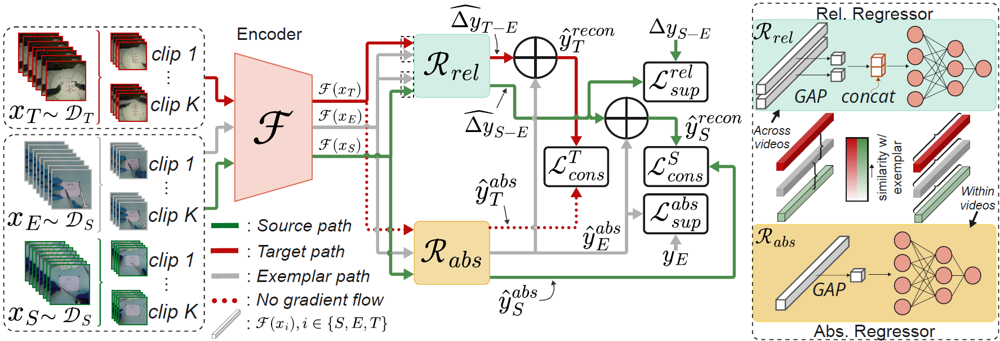

# CoRe-DA: Contrastive Regression for Unsupervised Domain Adaptation in Surgical Skill Assessment

This is the **official GitHub repository** for **"CoRe-DA: Contrastive Regression for Unsupervised Domain Adaptation in Surgical Skill Assessment"**, presented at **MICCAI 2026**.



**Paper:** [Springer / DOI](https://link.springer.com/chapter/10.1007/978-3-032-38233-7_8#citeas)

## Questions and Contact
For any questions about the code or the paper, please email
[dimanasta96@gmail.com]

## Setup

The experiments were developed using:

- **Python:** 3.10
- **PyTorch:** 2.7.1+cu118

### Data

1. Please request access to download the prepared datasets from **[this link](https://drive.google.com/drive/folders/1FTtVt2JZbyWM9LCo8yaUAZrKc4hEQPjJ?usp=sharing)**.
2. Extract the downloaded data into a local dataset directory `datasets/`.


## Training

From a terminal, navigate to the cloned repository:

```bash
cd CoRe-DA
```

Run experiment with:

```bash
python train.py \
    --exp experiment_name \
    --path_to_datasets path/to/datasets \
    --source_dataset aixsuture \
    --target_dataset jigsaws \
    --anno osats \
    --stop_grad_y_T \
    --use_cons_S \
    --mix_test
```

Replace `experiment_name` and `path/to/datasets` (full path) with your chosen experiment name and the actual dataset location. Other settings can be configured via `python train.py --help` (see opts.py).

The training code uses Weights & Biases for experiment tracking.

## Pretrained model weights

Model checkpoints (`.pth`) for the following experiments are provided below. **Add the download links before publishing.**

| Source domain | Target domain | Model checkpoint |
| --- | --- | --- |
| AIxSuture | JIGSAWS | [Download `.pth`](https://drive.google.com/file/d/1YSmSy3CwrZkjINeCSi63i8ui2T-cuMtz/view?usp=drive_link) |
| RAH-skill | RARP-skill | [Download `.pth`](https://drive.google.com/file/d/1H_p17LIcMtAcbe4FcyhdMmW8wF6RfpVe/view?usp=drive_link) |

## Citation

If you use this code or build on our work, please cite:

```bibtex
@incollection{anastasiou2027coreda,
  author    = {Anastasiou, Dimitrios and others},
  title     = {CoRe-DA: Contrastive Regression for Unsupervised Domain Adaptation in Surgical Skill Assessment},
  booktitle = {Medical Image Computing and Computer Assisted Intervention -- MICCAI 2026},
  series    = {Lecture Notes in Computer Science},
  volume    = {16892},
  publisher = {Springer},
  year      = {2026},
  doi       = {10.1007/978-3-032-38233-7_8},
}
```


## Attribution

The I3D backbone in `i3d.py` is adapted from [piergiaj/pytorch-i3d](https://github.com/piergiaj/pytorch-i3d), based on Carreira and Zisserman's *Quo Vadis, Action Recognition?*. Please review and retain any applicable upstream licence notices.
